# Estados y protocolos por módulo

Estado a OLA 0 (2026-08-19). Las máquinas "vigentes" vienen portadas de odontoflow
v1.6.2 y están verificadas contra el código (`packages/core/src/appointment-state.ts`,
`apps/web/src/app/api/**`, `apps/web/src/lib/{lycet,whatsapp,reminder-engine}.ts`).
Si el código y este texto divergen, **el código manda**. Adaptación dental→clínico:
paciente, doctor, servicio = prestación clínica. Las máquinas planificadas por ola se
listan al final y son de diseño hasta implementarse.

Convención de errores: `400` validación, `402 plan_insuficiente` (gating de plan),
`403` permisos, `409` conflicto/transición inválida con `error` en snake_case,
`502/503` integración externa caída (p. ej. `lycet_inaccesible`).

---

# MÁQUINAS VIGENTES (portadas)

## 1. Citas / consultas (packages/core/src/appointment-state.ts)

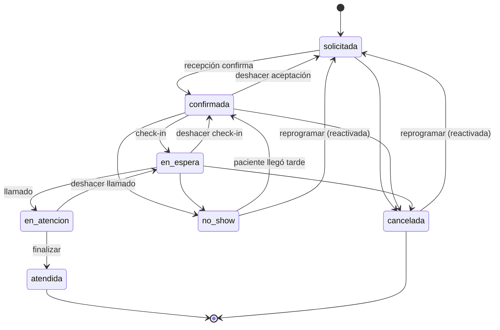

| Aspecto | Detalle |
|---|---|
| Flujo principal | `solicitada → confirmada → en_espera → en_atencion → atendida` |
| Cancelación | Desde `solicitada`, `confirmada`, `en_espera`. Desde `en_atencion` ya no (pasar a `en_espera` y cancelar desde ahí) |
| No-show | `confirmada → no_show` y `en_espera → no_show` |
| Reversibles | deshacer aceptación, deshacer check-in, deshacer llamado, `no_show → confirmada` |
| Terminales | `atendida` NUNCA revierte (corrección post-hoc = anular pago + kardex manual). `cancelada` se reactiva vía reprogramar |
| Reprogramar | `POST /api/citas/[id]/reprogramar` desde `solicitada`, `confirmada`, `cancelada`, `no_show` (409 `no_se_puede_reprogramar_en_<estado>`). Desde terminal reactiva como `solicitada` y notifica al paciente (`reprogramacion`) |
| Permisos | El permiso lo pide el estado DESTINO: `en_espera` → `checkin.perform`; `en_atencion`/`atendida` → `records.edit`; resto → `appointments.edit`. Doctor solo sus citas |
| Side effect `atendida` | Consume inventario al momento (FEFO); la respuesta expone `faltantes[]` |
| Sala de espera | Dialog de confirmación previa → POST estado → si reversible, toast "Deshacer" 5 s que ejecuta el POST inverso |
| Drag & drop agenda día | Solo `solicitada`/`confirmada` arrastrables; snap 15 min; cambio de doctor por columna; 409 `horario_ocupado` en toast |
| Error de transición | 409 `no_se_puede_pasar_de_<de>_a_<a>` |

## 2. Caja

### 2.1 Pagos: valido → anulado

```
 payments.estado:  valido ── anular (motivo ≥3 chars) ──▶ anulado   (nunca borrado físico)
```

- `POST /api/caja/pagos/[id]/anular` — `payments.register` (owner/recepción). No hay
  deshacer de la anulación; si fue error se registra un pago nuevo.
- 400 `motivo_requerido`; 404 `pago_no_encontrado`; 409 `ya_anulado`.
- **Bloqueo fiscal**: comprobante `aceptado` vinculado → 409
  `comprobante_sunat_aceptado_primero_dar_baja`.
- Efectos encadenados: comisiones → `monto = 0`; cuotas → `pendiente` (pagado 0,
  paymentId null); audit `pago.anular`.
- Exclusión de totales: los anulados no aparecen en cierre, dashboard ni ingresos por método.

### 2.2 Cierre diario: cerrado → reabierto

```
 POST /api/caja/cierre ──▶ fila nueva, estado cerrado (cierreSistema excluye anulados)
 POST /api/caja/cierre/[id]/reabrir ──▶ reabierto (solo owner + motivo) → nuevo cierre (otra fila)
```

- Reapertura: solo owner (403 `solo_owner_puede_reabrir`), motivo ≥3 (400), solo sobre
  filas `cerrado` (409 `cierre_no_cerrado`); audit `caja.reapertura`.
- "Cierre del día" = fila más reciente con estado `cerrado`. Rastro completo de
  intentos, nunca se pisa historia.

## 3. Comprobantes SUNAT (receipts.sunat_estado)

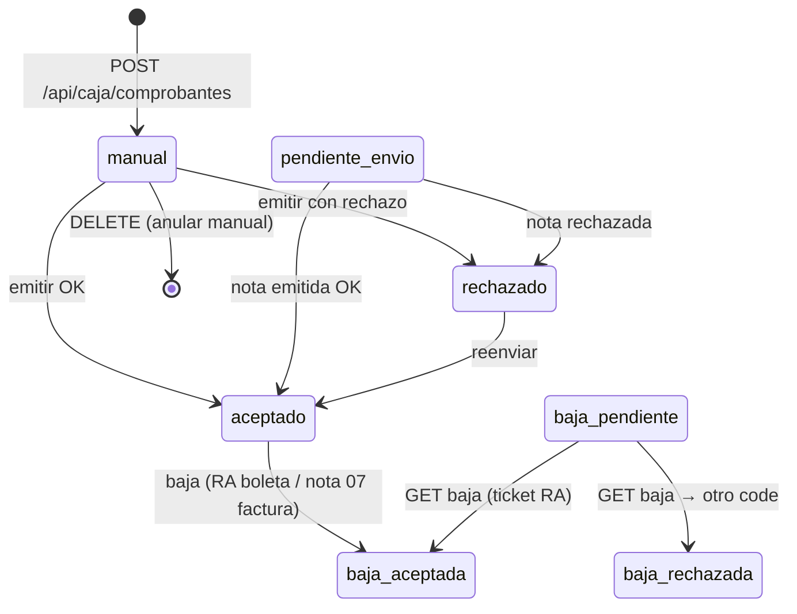

| Regla | Detalle |
|---|---|
| Emisión | `POST .../[id]/emitir` solo si no está `aceptado/baja*/baja_pendiente` (409 `comprobante_ya_emitido`). Aceptado = CDR code `"0"` o ≥4000; si falla marca `rechazado` (reenvío permitido) |
| Manuales | Solo `sunat_estado = manual`: editar serie/correlativo (PATCH, 409 `correlativo_ocupado`) y anular (DELETE físico + audit) |
| Baja (verificado contra SUNAT beta) | **Boleta: Resumen de Bajas** (RA, `/voided/send`, asíncrono, ticket → `baja_pendiente` → `baja_aceptada` al consultar code 0/≥4000). **Factura: nota de crédito tipoDoc 07** (codMotivo 01, síncrona) |
| Serie de nota | `B001 → BN01`, `F001 → FN01`; correlativo = MAX por serie + 1; `afectado_id` apunta al comprobante real |
| Reintento | Nota previa `pendiente_envio` → 409 `baja_en_curso`; previa `rechazada` → se reintenta con correlativo nuevo |
| Secuencia de corrección | 1º baja del comprobante → 2º anulación contable del pago |
| Configuración | `vat_settings` por tenant: SU RUC, usuario SOL, certificado PEM y Clave SOL cifrados at-rest con `LOCAL_MASTER_KEY`; ambiente beta/prod por `FE_URL` |
| Errores | 503 `lycet_no_configurado`, 502 `lycet_inaccesible`, 409 `rechazado_sunat`, `modo_manual`, `configuracion_incompleta`, `tipo_no_sujeto_a_baja` |

## 4. Lista de espera anti-huecos (waitlists)

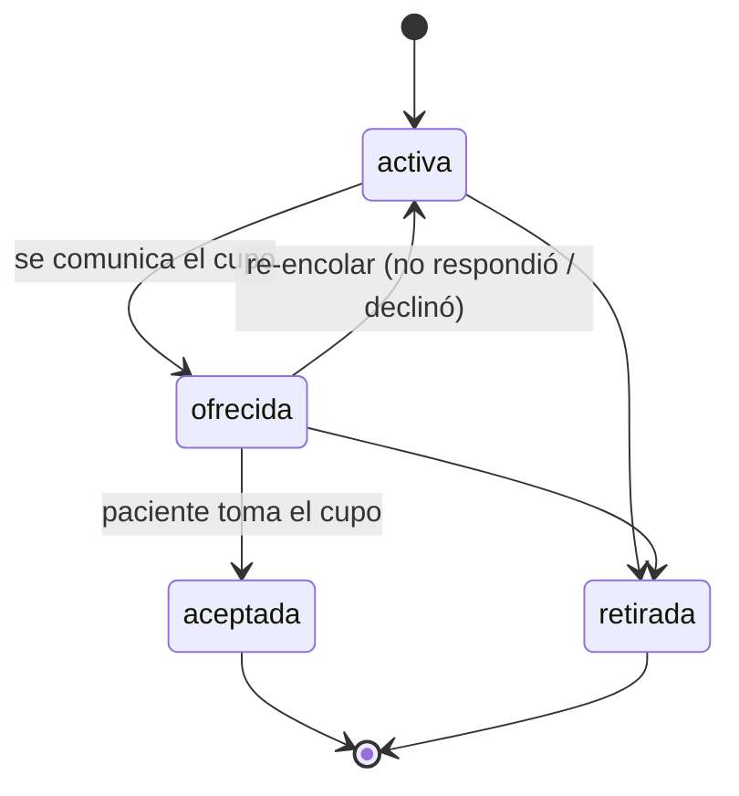

- Transiciones exactas: `activa → [ofrecida, retirada]`; `ofrecida → [aceptada, retirada, activa]`. Otra → 400 `transicion_invalida`.
- Re-encolar reintroduce al paciente en la selección por `prioridad ASC` para el siguiente hueco.
- Oferta: email con magic link (solo sobre `activa`); `ofrecida` es acción de recepción.

## 5. Cotización de tratamiento + cuotas (quotes/installments)

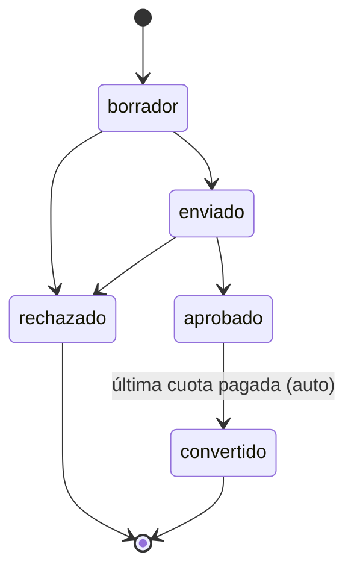

- `borrador → enviado → aprobado → convertido`; rechazo terminal. Sin deshacer: se crea cotización nueva.
- Cuotas: `POST /api/presupuestos/[id]/cuotas` (n 1..24, solo sobre `aprobado`, reparto exacto en céntimos).
- Pagar cuota: exige `paymentId` del mismo paciente (400 `pago_paciente_no_coincide`); ya pagada/cancelada → 400. Cierre automático: todas las cuotas pagadas → cotización `convertido`.
- `cancelada` en cuota = reestructurar plan (no si ya pagada). Cron `seguimiento` marca `vencida` (America/Lima).

## 6. Notificaciones y recordatorios (vigente base herencia)

Tipos: `recordatorio_24h`, `confirmacion_solicitud`, `recall`, `reprogramacion`, `waitlist`.

- Recordatorio 24h por cron (idempotente por cita) con fallback automático a email.
- WhatsApp Cloud API: plantillas de Meta fuera de la ventana de 24h; texto libre
  (`confirmacion`, `reprogramacion`) dentro de ventana. En clinicflow queda como
  add-on OLA 4; hoy el canal real es email (Resend) y dobles locales (Mailpit/whatsmock).
- Token mágico del paciente para reprogramar/cancelar sin cuenta; webhook verificado
  solo estampa `webhook_verified_at` en tenants con configuración completa.

## 7. Suscripción del tenant (cron renovaciones)

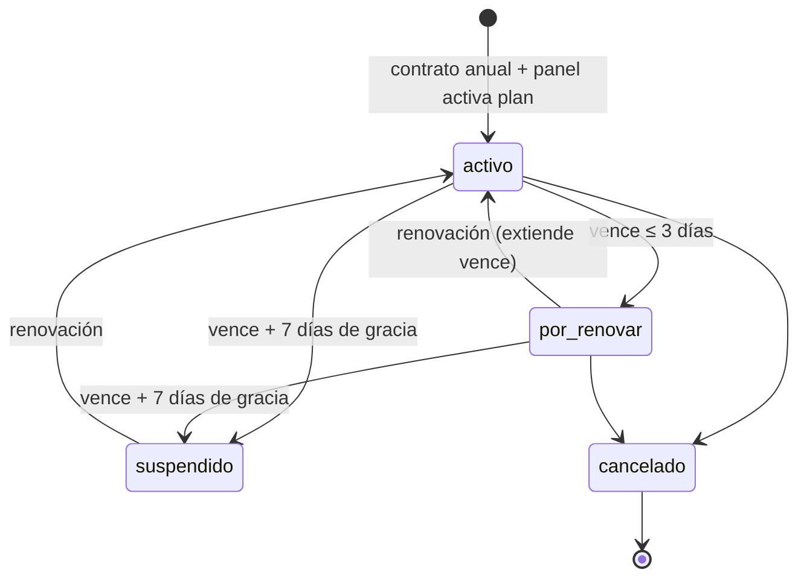

- `suspendido`/`cancelado` degradan en `gatePlan` (402 `plan_insuficiente`); la renovación reactiva al instante.
- Planes comerciales: Standard S/2,500 · Pro S/4,500 · Premium S/7,500 (contrato anual, cobro manual concierge).

## 8. Protocolo de deshacer/corrección (principios vigentes)

Toda corrección deja rastro (audit + motivo cuando aplica); nada se borra físicamente
salvo comprobantes manuales no enviados.

| Entidad | Quién | Ventana | Mecanismo |
|---|---|---|---|
| Cita en_espera/en_atencion | Staff con permiso del estado destino | 5 s (toast) o API después | POST estado inverso |
| Cita atendida | Nadie (terminal) | — | Anular pago + kardex de ajuste/merma manual |
| Cita cancelada/no_show | appointments.edit | Sin límite | Reprogramar → reactiva como solicitada + notificación |
| Pago | payments.register | Sin límite (tras baja del comprobante si existe) | Anular (motivo) — revierte comisiones y cuotas |
| Cierre diario | Solo owner | Mientras no haya cierre más reciente cerrado | Reabrir (motivo) + cerrar de nuevo |
| Comprobante manual | receipts.issue | Mientras sunat_estado = manual | PATCH serie/correlativo o DELETE |
| Comprobante aceptado | receipts.issue | Hasta que SUNAT acepte la baja | RA (boleta) o nota 07 (factura) |
| Waitlist | waitlist.manage | Mientras ofrecida | Re-encolar o retirar |
| Cuota | quotes.manage | Antes de pagada | Cancelar (reestructurar) |

## 9. Catálogo de códigos de error (vigente)

| HTTP | Claves | Cuándo |
|---|---|---|
| 400 | `json_invalido`, `motivo_requerido`, `estado_invalido`, `transicion_invalida`, `motivo_requerido_para_retroceder`, `cuota_ya_pagada`, `cuota_cancelada`, `n_invalido`, `pago_paciente_no_coincide`, `email_no_configurado` | Validación de entrada / estados no permitidos |
| 401 | `no_autorizado` | Cron sin Bearer CRON_SECRET válido |
| 402 | `plan_insuficiente` (+`requerido`, `plan_actual`) | Gating server-side de plan |
| 403 | `solo_owner_puede_reabrir`, `sin_permiso` | RBAC |
| 404 | `pago_no_encontrado` | Recurso fuera del tenant |
| 409 | `no_se_puede_pasar_de_<de>_a_<a>`, `ya_anulado`, `comprobante_sunat_aceptado_primero_dar_baja`, `ya_cerrada`, `cierre_no_cerrado`, `comprobante_ya_emitido`, `rechazado_sunat`, `correlativo_ocupado`, `horario_ocupado`, `baja_en_curso`, `tipo_no_sujeto_a_baja`, `modo_manual`, `configuracion_incompleta`, `pago_ya_con_comprobante`, `no_se_puede_reprogramar_en_<estado>` | Conflicto de estado/transición/recurso |
| 429 | + `Retry-After` | Rate limit in-memory |
| 502/503 | `lycet_inaccesible`, `lycet_no_configurado`, `consulta_fallida` | Integración externa caída o sin credenciales |

## 10. Crons (apps/web/src/app/api/cron/*)

Los endpoints aceptan solo `POST` con `Authorization: Bearer $CRON_SECRET` (401 sin
secret configurado — fail-closed). En producción los corre el contenedor cron
(supercronic, `CRON_TZ=America/Lima`); en dev, el programador de Windows.

| Job | Frecuencia | Comportamiento |
|---|---|---|
| `recordatorios` | Cada hora | Recordatorio 24h a citas confirmadas de mañana (idempotente por cita); reintento de reminders en error (48h) |
| `renovaciones` | Cada hora | §7: por_renovar → aviso → suspendido tras 7 días de gracia |
| `fiscal` | Cada hora | Reemite `pendiente_envio` (≤7d) y `rechazados` (≤48h) |
| `diario` | Diario 08:00 Lima | Digest al gerente (caja, stock bajo, órdenes pendientes) |
| `recall` | Diario | Pacientes dormidos ≥6 meses con recall activo (dedupe 60 días) |
| `seguimiento` | Diario | Cotizaciones enviado ≥3/≥7 días (una vez cada aviso); cuotas → vencida |
| backup | Diario 03:40 Lima | pg_dump -Fc → ./backups, retención 30 días |

---

# MÁQUINAS PLANIFICADAS POR OLA

Diseño fijado; la implementación llega con su ola y cada una vivirá en
`packages/core` como máquina validada server-side.

## 11. Triaje (OLA 1)

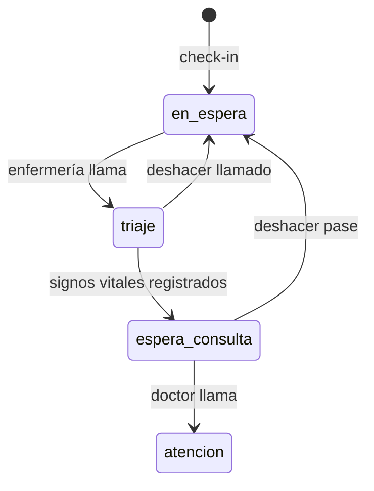

- Se interpone entre check-in y atención: `en_espera → triaje → espera_consulta → atencion`.
- El registro de signos vitales en triaje es obligatorio para pasar a `espera_consulta`.
- Retrocesos de un paso con deshacer 5s (mismo protocolo que sala de espera vigente).

## 12. Hospitalización (OLA 2)

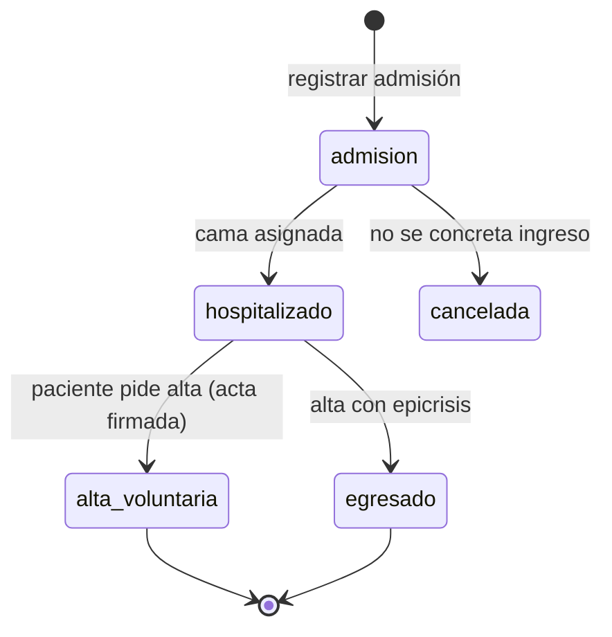

- `admision → hospitalizado` exige cama asignada (ver §13).
- Egreso exige epicrisis firmada (documento PDF en adjuntos).
- Alta voluntaria: consentimiento/acta canvas→PDF obligatoria; cierra la admisión sin epicrisis médica.

## 13. Cama (OLA 2)

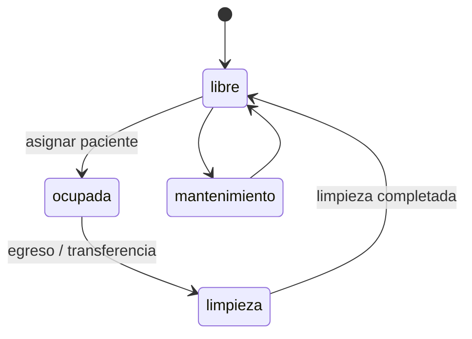

- Transferencia de cama: cierra el `bed_assignments` actual (fin) y crea uno nuevo; la cama de origen pasa a `limpieza`.
- Ocupación % = camas `ocupada` / total habilitadas (KPI del dashboard OLA 4).

## 14. Orden diagnóstico — laboratorio e imagen (OLA 2)

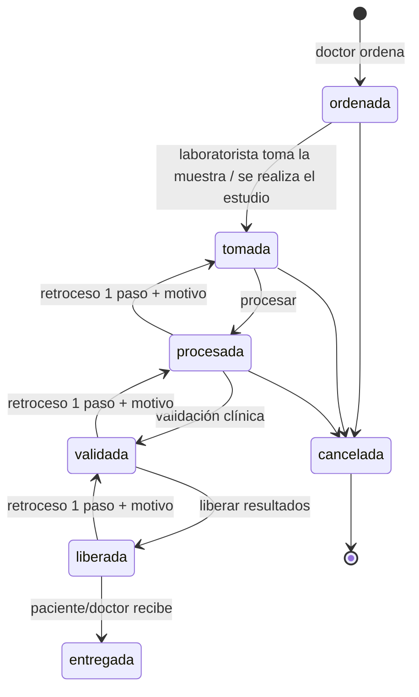

- Flujo canónico (referencia openemr): orden→toma→resultado→validación→liberación→entrega.
- Retroceso de **un solo paso** con motivo ≥3 chars (`rev + 1`, `motivo_revision`),
  idéntico al protocolo del laboratorio heredado de odontoflow (400
  `motivo_requerido_para_retroceder` / `transicion_invalida`).
- `liberada` habilita visibilidad en el portal del paciente; hasta entonces el
  resultado es interno. Imagen usa la misma máquina con estados equivalentes
  (ordenada→informada→entregada).

## 15. Cirugía (OLA 3)

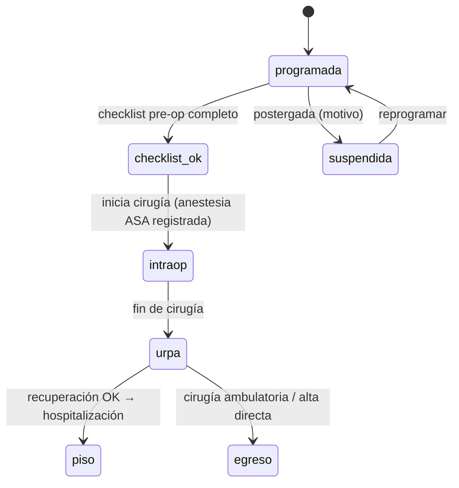

- `checklist_ok` es condición para `intraop` (409 si falta checklist).
- Registro intraoperatorio (inicio/fin, equipo, complicaciones) y URPA con destino piso/egreso.

## 16. Dispensación de farmacia (OLA 2)

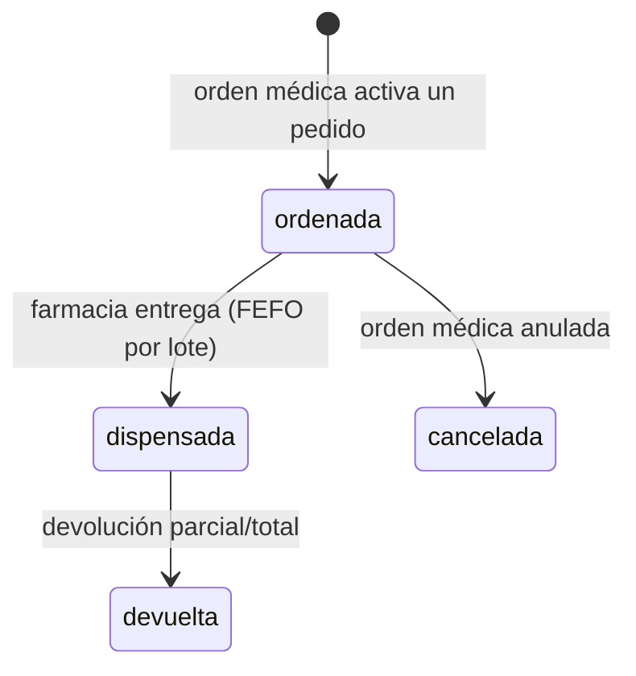

- Dispensación ligada a la orden médica: sin orden activa no se dispensa.
- FEFO: lotes ordenados por `vence ASC NULLS LAST`; faltantes no bloquean la orden
  médica pero quedan expuestos (como el consumo de inventario heredado).
- Devolución genera `stock_movements` de ajuste con motivo.
